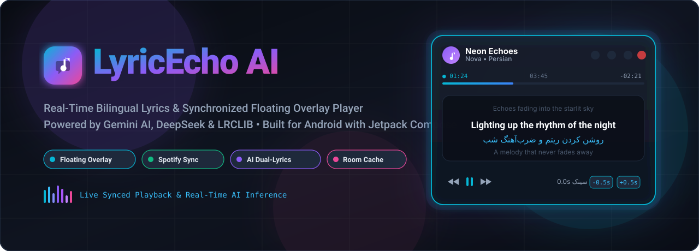
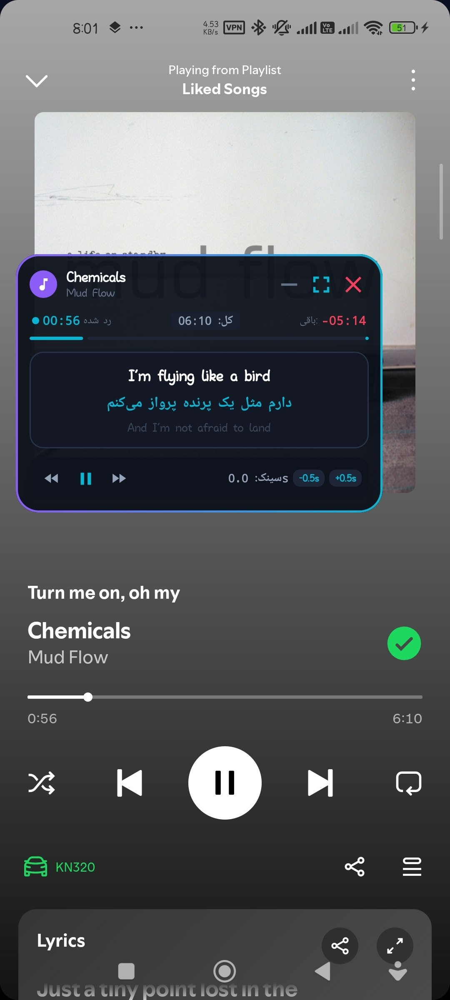
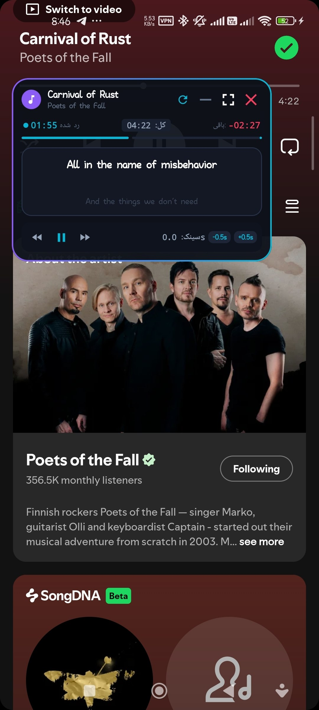
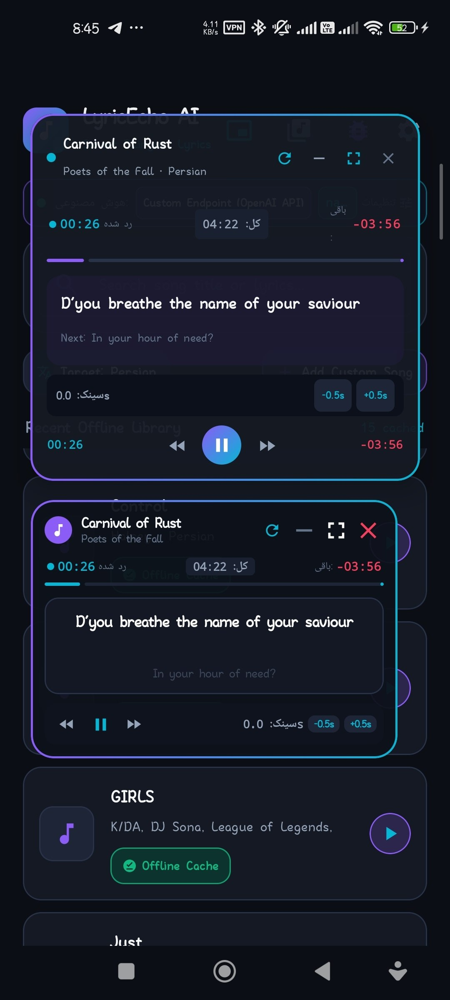
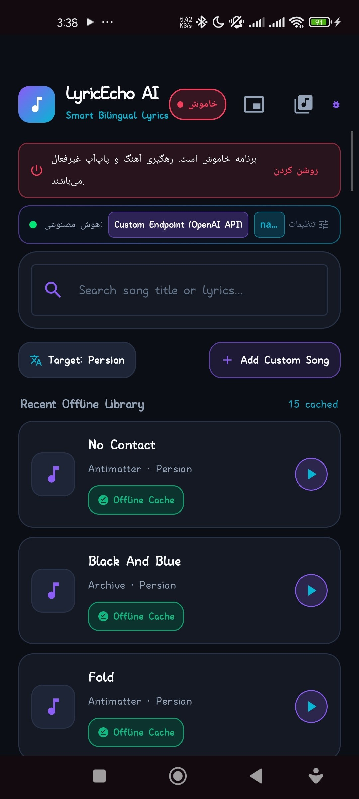
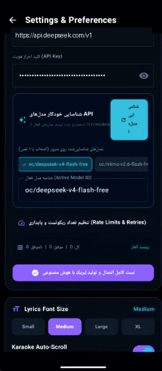
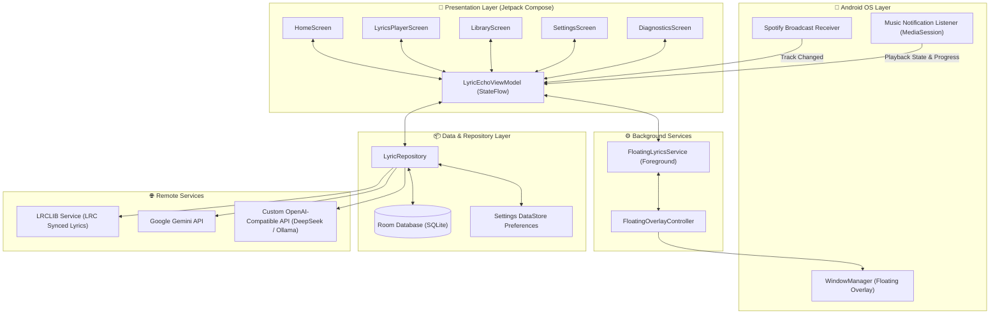

<p align="center">
  
</p>

<p align="center">
  <a href="https://github.com/shinigami6669/LyricEcho-AI/releases/latest"></a>
  <a href="https://github.com/shinigami6669/LyricEcho-AI/stargazers"></a>
  <a href="https://github.com/shinigami6669/LyricEcho-AI/network/members"></a>
  <a href="https://github.com/shinigami6669/LyricEcho-AI/blob/main/LICENSE"></a>
  <a href="https://developer.android.com"></a>
  <a href="https://kotlinlang.org"></a>
  <a href="https://developer.android.com/jetpack/compose"></a>
</p>

<p align="center">
  <a href="https://github.com/shinigami6669/LyricEcho-AI/releases/latest">
    
  </a>
</p>

---

# 🎵 LyricEcho AI

> **Real-Time Bilingual Lyrics & Synchronized Floating Overlay Player for Android**  
> Inspired by Musixmatch, supercharged with Google Gemini & Custom LLMs, LRCLIB synchronized lyrics, and zero-latency Room database persistence.

**LyricEcho AI** is a native Android application designed for music lovers and language learners. It automatically detects songs playing on your device (via Spotify, YouTube Music, Apple Music, etc.), retrieves time-synced lyrics, and translates them line-by-line using advanced AI into your preferred language (with first-class support for Persian/Farsi, Spanish, French, German, Japanese, Arabic, and more).

All of this happens right on your screen via an interactive **Floating Window Overlay** that sits above your music app, complete with playback controls and millisecond sync adjustments!

---

## 🌟 Visual Showcase

<div align="center">
  <table>
    <tr>
      <td width="33%" align="center">
        <b>🪟 Floating Overlay on Spotify</b><br/><br/>
        
      </td>
      <td width="33%" align="center">
        <b>⚡ Live Music Tracking</b><br/><br/>
        
      </td>
      <td width="33%" align="center">
        <b>🎛️ Detailed Window Controls</b><br/><br/>
        
      </td>
    </tr>
    <tr>
      <td width="33%" align="center">
        <b>📱 Home & Offline Library</b><br/><br/>
        
      </td>
      <td width="33%" align="center" colspan="2">
        <b>⚙️ Multi-Model AI Hub & Custom Endpoints</b><br/><br/>
        
      </td>
    </tr>
  </table>
</div>

---

## ✨ Key Features

### 🪟 Real-Time Floating Karaoke Overlay (System Alert Window)
- **Always on Top**: Floats seamlessly over Spotify, YouTube Music, SoundCloud, or any media player.
- **Interactive Controls**: Play, pause, skip, track seeker, and minimize/maximize buttons without leaving your music app.
- **Micro-Sync Adjustment**: Fine-tune lyrics timestamp alignment on-the-fly (`-0.5s` / `+0.5s`) for perfect audio-lyric harmony.
- **Dual-Line Presentation**: Displays the original lyrics on top and the culturally nuanced AI translation directly below.

### 🧠 Dual AI Translation Engine (Gemini & Custom LLMs)
- **Google Gemini API**: Native integration for fast, context-aware, poetic translations.
- **OpenAI-Compatible Custom Endpoints**: Connect any server or proxy (DeepSeek V3/R1, Ollama, OpenRouter, Groq, vLLM, etc.).
- **Automatic Model Discovery**: Probes `/v1/models` in real time with latency benchmarking (ms ping) and one-tap model selection.
- **Reasoning Model Support**: Automatically handles and cleans `<think>` reasoning tags from DeepSeek-R1 and similar architectures.

### 🎧 Automatic Song Detection & Media Session Tracking
- **Spotify Broadcast Receiver**: Intercepts `com.spotify.music.playbackstatechanged` for zero-lag track updates.
- **Media Notification Listener**: Monitors Android MediaSession to capture active song metadata (Title, Artist, Duration, Progress) across all players.

### ⚡ Offline-First Architecture (Room Database)
- **Zero Latency (0ms)**: Previously translated songs are saved in local SQLite storage.
- **Save Quota**: Never spend AI tokens twice on the same track.
- **Clear Status Badges**: Visual indicators for `[Offline Cache]` (Emerald) and `[AI Live]` (Sky Cyan).

### 🎨 Modern Jetpack Compose UI
- **Design System**: Premium Dark Obsidian theme (`#080B11`), Electric Violet (`#8B5CF6`), and Cyan Horizon (`#06B6D4`).
- **Bilingual Typography**: Tailored font rendering supporting bidirectional RTL (Persian / Arabic) and LTR scripts.
- **Diagnostics Screen**: Live terminal displaying HTTP calls, network latencies, and service logs in real time.

---

## 🏗️ Technical Architecture

LyricEcho AI is built following modern Android Architecture Components (Clean Architecture + MVVM + Offline-First Repository):



---

## 🛠️ Tech Stack & Libraries

| Category | Technologies |
| :--- | :--- |
| **Language** | [Kotlin 2.0+](https://kotlinlang.org/) |
| **UI Framework** | [Jetpack Compose](https://developer.android.com/jetpack/compose) with [Material 3](https://m3.material.io/) |
| **Architecture** | MVVM, Clean Architecture, Unidirectional Data Flow (UDF) |
| **Async & Reactive** | Kotlin Coroutines & StateFlow / SharedFlow |
| **Local Database** | [AndroidX Room](https://developer.android.com/training/data-storage/room) with KSP compiler |
| **Settings Storage** | Jetpack DataStore Preferences |
| **Networking** | OkHttp 4, Retrofit 2, Moshi (JSON parsing) |
| **AI Integration** | Google Gemini API (v1beta) + Custom OpenAI-compatible REST API |
| **Media & Lyrics** | AndroidX MediaSession, Android MediaNotificationListener, LRCLIB API |
| **Image Loading** | Coil Compose |

---

## 🚀 Getting Started

### Prerequisites
- **Android Studio**: Ladybug (2024.2.1) or newer recommended
- **JDK**: Version 17 or higher
- **Android SDK**: `minSdk = 24` (Android 7.0 Nougat), `targetSdk = 36`

### 1. Clone the Repository
```bash
git clone https://github.com/shinigami6669/LyricEcho-AI.git
cd LyricEcho-AI
```

### 2. Configure Environment Variables
Copy `.env.example` to `.env` in the root folder:
```bash
cp .env.example .env
```
Open `.env` and add your Gemini API Key:
```properties
GEMINI_API_KEY=your_gemini_api_key_here
```
*(Alternatively, you can leave it blank and configure your custom API key or private endpoint inside the app's Settings screen at any time).*

### 3. Build & Run
Open the project in Android Studio and hit **Run** (`Shift + F10`), or build via Gradle:
```bash
./gradlew assembleDebug
```

---

## 🔐 Permissions Overview

LyricEcho AI requires the following Android permissions to deliver its seamless experience:

| Permission | Reason |
| :--- | :--- |
| `SYSTEM_ALERT_WINDOW` | Required to display the floating lyrics overlay on top of other apps. |
| `BIND_NOTIFICATION_LISTENER_SERVICE` | Required to read active music playback information from Spotify and other media players. |
| `INTERNET` | Required to query LRCLIB for lyrics and AI endpoints for translations. |
| `FOREGROUND_SERVICE` | Keeps the floating lyrics window alive and synchronized in the background. |
| `POST_NOTIFICATIONS` | Displays playback controls and service status in the notification shade (Android 13+). |

---

## 🇮🇷 راهنمای فارسی (Persian Overview)

**لیک‌اکو (LyricEcho AI)** یک اپلیکیشن مدرن و پیشرفته اندروید است که تجربه گوش دادن به موسیقی را متحول می‌کند:

- **پاپ‌آپ شناور هوشمند (Floating Overlay)**: نمایش متن آهنگ و ترجمه فارسی آن به صورت پنجره شناور روی اسپاتیفای و سایر موزیک‌پلیرها، همراه با کلیدهای کنترل پخش و تنظیم دقیق زمان‌بندی (سینک).
- **ترجمه زنده با هوش مصنوعی**: پشتیبانی از دو موتور قدرتمند:
  1. **Google Gemini API**: ترجمه‌های دقیق، روان و دارای مفهوم شعری.
  2. **سرورهای سفارشی (OpenAI Compatible)**: امکان اتصال به مدل‌های DeepSeek، سرورهای شخصی، Ollama و پروکسی‌ها با شناسایی خودکار مدل‌ها (`/v1/models`).
- **تشخیص خودکار آهنگ**: بدون نیاز به تایپ، به محض پخش موزیک در اسپاتیفای یا پلیرهای دیگر، نام آهنگ و موقعیت زمانی آن دریافت شده و لیریک همگام‌سازی می‌شود.
- **کش آفلاین بدون تاخیر (Room DB)**: آهنگ‌هایی که قبلاً ترجمه شده‌اند بلافاصله از حافظه دستگاه بارگذاری می‌شوند تا حجم اینترنت و توکن‌های هوش مصنوعی هدر نرود.
- **پشتیبانی کامل از زبان فارسی**: فونت‌های خوانا و راست‌به‌چپ (RTL) به همراه زبان‌های اسپانیایی، فرانسوی، آلمانی، ژاپنی و عربی.

---

## 🤝 Contributing

Contributions, issues, and feature suggestions are warmly welcome!  
Feel free to open an issue or submit a pull request:

1. Fork the Project
2. Create your Feature Branch (`git checkout -b feature/AmazingFeature`)
3. Commit your Changes (`git commit -m 'Add some AmazingFeature'`)
4. Push to the Branch (`git push origin feature/AmazingFeature`)
5. Open a Pull Request

---

## 📜 License

Distributed under the **MIT License**. See [`LICENSE`](LICENSE) for more information.

---

<p align="center">
  Crafted with ❤️ by <a href="https://github.com/shinigami6669">shinigami6669</a>
</p>
